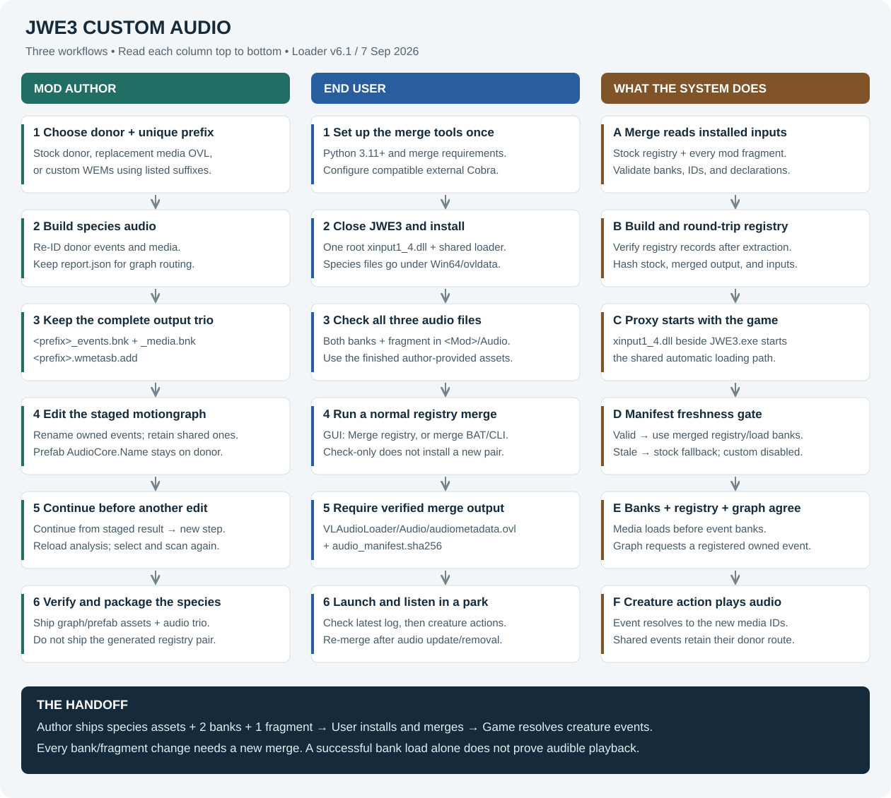

# JWE3 custom audio: installation and authoring

Workflow reference · 7 September 2026 · Loader v6.1

Custom species audio needs **three cooperating parts**: uniquely identified sound
banks, a motiongraph that requests their events, and a merged registry that lets
the game resolve those events. Installing banks alone is insufficient.

This guide covers the current local Audio Kit and custom Motiongraph Editor.
It includes the recent **Continue from staged result** action. It describes a
donor-based species workflow; it does not claim arbitrary new Wwise event or
bank structures are supported.



## 1. Choose your route

| You want to… | Follow |
| --- | --- |
| Install somebody else's finished custom-audio species | Sections 2–5 |
| Give your species a donor's audio under independent IDs | Sections 6–10 |
| Use a downloaded replacement sound pack only on your species | Sections 6–10, replacement-OVL option |
| Supply your own recordings | Sections 6–10, custom-WEM option |
| Diagnose silence or a failed merge | Section 11 |

**Terms:** `<game>` means the folder containing `JWE3.exe`. `<Mod>` means your
species mod's folder name. A **donor** supplies the existing event/bank structure.
A **prefix** is your new audio namespace; it need not equal the mod folder name.

## 2. End user: one-time setup

1. Install **64-bit Python 3.11 or newer**, available as `python` in your terminal.
2. Obtain the Audio Kit and the compatible shared loader from the mod's release.
   Keep the kit files together. This checkout's current distribution instructions
   expect you to supply Cobra separately; do not assume a release includes it.
3. Obtain a **compatible Cobra checkout**. Select the folder containing
   `ovl_tool_cmd.py`, not its parent. For this workspace, the maintained editor
   used by this guide is `Cobra Dev/cobra-tools-master`; its custom editor features
   may not be present in a generic upstream download.
4. Open a terminal in `JWE3 Audio Kit` and install the merge dependencies:

```bat
python --version
python -m pip install -r requirements.txt
```

The merge requirements currently contain numpy, imageio, bitarray, and pillow.
Use the same Python interpreter to install dependencies and run the kit.

### Optional setup and merge GUI

The current `audio_kit_gui.py` imports **PyQt5**, which is not included in the
four-package requirements file. Install it separately if this GUI is wanted:

```bat
python -m pip install PyQt5
python audio_kit_gui.py
```

Choose **Cobra tools → Browse**, select the checkout, then **Save settings**.
The path is stored in `audio_tools.json` beside the scripts. The green status
confirms the entry-point file exists; a successful merge/check is the functional
test. Set **Game root** when auto-detection finds the wrong installation.

Alternatively, pass `--cobra` and `--game` to the command line. Cobra selection
priority is explicit `--cobra`, then `JWE3_COBRA_TOOLS`, then `audio_tools.json`.
Legacy bundled/sibling fallbacks still exist in code. An invalid explicit
configuration is an error, not an invitation to silently select another copy.
For reliable CLI targeting, pass `--game` or set `JWE3_GAME`; do not rely on the
GUI's saved Game root being read by every CLI tool.

## 3. End user: install a finished mod

Close JWE3 before installation, updating files, or merging. Back up any existing
loader and generated registry pair before replacing the shared component.

```text
<game>/
  JWE3.exe
  xinput1_4.dll                         shared startup proxy
  merge_registry.bat                  launcher, when supplied
  JWE3 Audio Kit/                      merge scripts and optional GUI
  Win64/ovldata/
    VLAudioLoader/
      Manifest.xml                    ContentPack manifest; supplied with loader
      VLAudioLoader.dll               optional legacy entry point
      Audio/
        audiometadata.ovl              generated locally by the merge
        audio_manifest.sha256          generated locally; paired with the OVL
    <Mod>/
      ...species mod files...
      Audio/
        <prefix>_events.bnk
        <prefix>_media.bnk
        <prefix>.wmetasb.add
```

1. Put **`xinput1_4.dll` beside `JWE3.exe`**, not inside `Win64` or `ovldata`.
   Use the corrected v6.1 loader release; the original v6 had a startup crash.
2. Install one shared **`VLAudioLoader`** folder under `Win64/ovldata`.
   Every custom-audio mod shares it. Do not manually call the optional legacy DLL
   when the root proxy is already handling loading.
3. Install the species mod in its own folder under `Win64/ovldata`.
   Verify that **both banks and the `.wmetasb.add` fragment** are present.
4. If another unrelated proxy already owns `xinput1_4.dll`, resolve that conflict
   before replacing it. Two DLLs cannot occupy the same root filename.
5. Run the merge described next. Finished species releases should not require
   end users to edit motiongraphs, build banks, or run codegen.

## 4. End user: merge, launch, verify

Double-click the supplied root `merge_registry.bat`, or use **Merge registry**
in the Audio Kit GUI. If a root launcher was not supplied, run the kit's script
with the game path explicitly:

```bat
python merge_audio_registry.py --game "C:/Program Files (x86)/Steam/steamapps/common/Jurassic World Evolution 3" --cobra "D:/Tools/cobra-tools-master"
```

Replace the Cobra example path with your own checkout. Run this from the kit
folder. **Require a successful merge before launching.** It reads stock metadata
and all installed fragments, validates banks and conflicts, verifies the built
registry by extracting it again, and writes the generated OVL/manifest pair into
`VLAudioLoader/Audio`.

**Check (read-only)** or `--check` validates inputs without installing output.
It does not refresh the installed registry/manifest. `--output DIR` builds a
staged pair instead; that pair must then be installed together.

On the next launch, inspect the newest section of `<game>/VLAudioLoader.log`:

- The expected loader version is present.
- `Audio manifest verified` appears.
- Each expected unique bank loads with `AKRESULT=1`.

Then load a park and trigger the species' actual actions. **Successful bank
loading is not proof that the creature posts the right event or plays it.**
Check its roars, stock/shared effects, and another custom-audio species if installed.

## 5. End user: updates and removal

| Change | Merge again? |
| --- | --- |
| Add or remove an audio mod | Yes |
| Replace/rebuild either `.bnk`, even under the same filename | Yes |
| Change a `.wmetasb.add` fragment | Yes |
| A game update changes stock audio metadata | Yes |
| Launch again with all audio inputs unchanged | No |
| Only change a graph/prefab, with banks and fragments unchanged | Not for manifest freshness; restart and verify event routing |

The hash manifest checks contents, not just filenames or timestamps. One stale
input disables automatic custom-bank loading for the installation until a valid
merge is installed. Stock fallback does not make newly renamed custom events work.

To remove a species, remove its mod folder with JWE3 closed and merge again.
Retain the shared loader while another audio mod uses it. If retaining the loader
after removing the last audio mod, run the merge to rebuild stock-only metadata.

## 6. Mod author: plan the namespace and inputs

Worked example: donor **Indoraptor**, audio prefix **VLIndo**, mod folder
**VLIndoSpecies**. These are example names, not an instruction to rename a
working species wholesale.

The prefix must start with a letter, use ASCII letters/digits/underscores, and
differ from the donor. Coordinate a distinct namespace across mods. The current
GUI scan still rejects a prefix longer than the donor, even though the bank
builder supports one and the graph apply path has relocation code. A shorter
prefix avoids that inconsistency; `VLIndo` fits `Indoraptor`.

Prepare a fresh build-output directory and a complete staged species archive
family. Preserve the original `.ovl`, all relevant `.ovs.*`, and hashed `.aux`
companions. Work on staging, not `Content0` or the live species installation.

| Audio source | Builder option | What it does |
| --- | --- | --- |
| Stock donor voice | No extra option | Creates independently identified copies of donor events/media |
| Replacement sound pack | `--sound-mod PATH` | Uses the replacement donor media OVL as the sound source |
| Your own sounds | `--sounds DIR` | Replaces media behind recognized donor event suffixes with your WEM files |
| Distinctive test sound | `--marker-from PATH` | Uses a media OVL as a marker source for listening tests |

Keep a replacement media OVL with its AUX companions. Do not install that
replacement into `Content0` when the intent is custom-species-only audio.
Use audio you can include in your release; the builder does not grant rights
to someone else's recordings or replacement pack.

## 7. Mod author: build the three audio files

### GUI route — no command typing needed

Open **Motiongraph Editor → Audio Events**. You can build banks here before
loading a graph; graph loading is needed for the later rename step.

| Command argument | GUI control |
| --- | --- |
| `--donor Indoraptor` | **Donor species:** `Indoraptor` |
| `--prefix VLIndo` | **New prefix:** `VLIndo` |
| `--game ...` | **Game folder → Browse** |
| `--cobra ...` | Automatically uses the checkout running this editor |
| `--out ...` | **Output folder → Browse** |
| `--sound-mod ...` | Optional **Replacement sound mod → Browse** |
| `--sounds ...` | Optional **Custom WEM folder → Browse** |
| `--marker-from ...` | Optional **Marker media OVL → Browse** |

For stock donor audio, leave the three optional input fields blank and press
**Build species audio banks**. For a replacement pack, select its media OVL
first. Builds run in the background and report completion/errors in the editor.

For your own WEMs, the complete GUI sequence is:

1. Fill the donor, prefix, game, and output fields.
2. Press **Build baseline / discover WEM names**. This build ignores the Custom
   WEM and Marker fields and creates the suffix list with the baseline banks.
3. Press **Open WEM suffix list**. Name your compatible WEM files after the
   listed suffixes and place them in a folder using your file manager.
4. Select that folder in **Custom WEM folder**, choose a fresh output folder,
   and press **Build species audio banks**.
5. Press **Open build report** and **Open output folder** to inspect the results.
   Copy both banks and the fragment together during the integration step.

Use **Marker media OVL** for a test build; clear Custom WEM folder first. Encoding
WAV/MP3 recordings into game-compatible WEMs remains an external audio-tool step.
The editor does not perform that conversion.

### Optional command-line equivalent

From the Audio Kit folder, this one-line command works in PowerShell or CMD:

```bat
python build_species_audio.py --donor Indoraptor --prefix VLIndo --game "C:/Program Files (x86)/Steam/steamapps/common/Jurassic World Evolution 3" --cobra "D:/JWE2 Stuff/Cobra Tool Versions/Main Mod Kit/Cobra Dev/cobra-tools-master" --out "D:/AudioBuilds/VLIndo"
```

For a replacement pack, append `--sound-mod "D:/SoundPack/Indoraptor_media.ovl"`.
Keep the donor consistent with the replacement pack's expected bank structure.
Merely renaming a bank file does not change its internal identifiers.

The builder produces:

| Output | Use |
| --- | --- |
| `vlindo_events.bnk` | Ship in the mod's `Audio` folder |
| `vlindo_media.bnk` | Ship in the same folder |
| `vlindo.wmetasb.add` | Ship beside both banks; required for the merge |
| `report.json` | Authoring reference: IDs and graph rename/leave-alone lists |
| `sounds_available.txt` | Recognized custom-WEM suffixes for this donor build |

Use the builder's real bank outputs. A `.bnk` stub extracted by Cobra is not a
substitute for a complete bank payload.

### Your own recordings

1. Make a baseline build first to obtain `sounds_available.txt` and `report.json`.
2. Encode your recordings as Wwise `.wem` media compatible with the target game.
   This kit does not convert WAV/MP3 into WEM or choose encoding settings for you.
3. Choose a suffix exactly as listed in `sounds_available.txt`; name the file
   `<ListedSuffix>.wem`, without adding the donor or new prefix.
4. Place the WEMs in one folder and rebuild into a fresh output folder using
   `--sounds "D:/AudioSources/VLIndoWems"` appended to the base command.
5. Resolve unmatched, empty, or conflicting replacement errors. When multiple
   events share media, replacing one can affect the others; incompatible
   replacements for the same media are rejected.

This adapts the donor's existing event structure. It is not a general-purpose
Wwise project compiler for arbitrary new event graphs. Reinstall the entire
output trio and rerun the merge after every bank rebuild.

### Builder through the Motiongraph Editor

Open **Audio Events**, enter Game folder, Donor species, and New prefix, then
choose the replacement-media OVL if needed and an output folder. Press **Build
species audio banks**. It invokes the same Audio Kit builder. It requires the
kit to be discoverable near this custom Cobra checkout and a working Cobra path
configuration for other kit operations. The build itself explicitly uses the
editor's Cobra checkout. Custom WEMs, marker builds, and baseline discovery are
also exposed here; the command line is optional.

## 8. Mod author: connect the graph and prefab

Building banks does not change the creature's event names. The graph must request
the new owned events while leaving shared events on their existing names.

1. Open the species' current source OVL in the Motiongraph Editor and load it.
   In **Stage / Apply**, choose a separate folder and **Copy full family**.
2. In **Audio Events**, use exactly the donor and prefix used for the bank build.
3. Press **Scan graph for audio events**. Compare its selections with
   `report.json`: rename only names in `motiongraph_RENAME` and retain names in
   `motiongraph_LEAVE_ALONE`. Shared-bank entries are deliberately excluded.
4. Press **Rename ticked events in staged family**. Require success and inspect
   the reported changes. Copy the builder's existing fragment; **Write registry
   fragment** is an alternative authoring route, not a replacement for building
   the matching banks or for the installation-time merge.
5. Before making another distinct graph edit, choose **Stage / Apply → Continue
   from staged result**. It preserves the result, creates separate source/output
   copies for the next step, and reloads analysis. Old queues and selections are
   cleared; select and scan again. Apply intended queued changes before continuing.
6. Ensure the prefab's **`MotionGraphName`** points to the intended graph resource.
   Keep **`AudioCore.Name` equal to the donor** (`Indoraptor` in this example):
   engine-generated shared events such as footsteps must retain their donor route.

Do not bulk-replace every occurrence of the donor name. A shared event moved to
your namespace can become silent. There is no codegen step for ordinary bank
building, graph event edits, or installation; codegen is for Cobra format-source
development.

## 9. Mod author: integrate and verify

With the game closed, install your verified staged species family and copy
the three audio files into `<game>/Win64/ovldata/VLIndoSpecies/Audio/`.
Install the shared loader if needed, then run a normal registry merge.

Use this acceptance sequence:

1. **Build evidence:** all three outputs exist; report has the expected donor,
   prefix, and rename/leave-alone sets.
2. **Archive evidence:** the staged graph reloads and requested owned-event
   renames are present; untouched/shared events remain intact.
3. **Merge evidence:** registry verification succeeds and the generated pair is
   installed together for this exact combination of mods.
4. **Loader evidence:** newest launch log verifies the manifest and reports
   successful loads for the expected banks, with media available before events.
5. **Playback evidence:** the creature itself triggers the intended sounds.
   Exercise multiple actions and repeated/random variations. Use a distinctive
   marker build when the source and new audio are difficult to distinguish.
6. **Coexistence evidence:** the vanilla donor retains its intended stock voice,
   shared effects work, and another installed custom-audio species still works.
7. **Release evidence:** test a clean install of your packaged files and an
   uninstall followed by re-merge. Keep build inputs/reports for reproducibility.

Offline success is tool verification. Only observed creature-driven playback
establishes that the tested build works in the game. A manually posted diagnostic
event bypasses the creature's normal event-selection path.

## 10. Mod author: package for users

Ship the verified species assets and the **complete audio trio** in the mod's
own `Audio` folder. Include a concise dependency/install note:

> Requires the compatible shared VLAudioLoader v6.1 release and JWE3 Audio Kit.
> Close JWE3, install this mod under Win64/ovldata, then run the registry merge.
> Rerun the merge after updating or removing this mod, including replacing banks
> under the same filenames. All three files in Audio are required.

Do **not** include your generated `audiometadata.ovl`, generated
`audio_manifest.sha256`, machine-specific `audio_tools.json`, or replacement
stock `Content0` files in a species release. The user generates the shared pair
for their own mod combination. A ContentPack `Manifest.xml` is a different file
with a different purpose; do not confuse it with the generated hash manifest.

The shared loader is installed once. Identify the required release instead of
letting different species packages silently overwrite it with different DLLs.

## 11. Troubleshooting by the failing step

| Symptom | Check / action |
| --- | --- |
| Audio Kit GUI reports missing PyQt5 | Install PyQt5 using the same Python, or use the CLI merge |
| Cobra not found / configured directory invalid | Select the directory that actually contains `ovl_tool_cmd.py`; save settings or pass `--cobra` |
| Wrong game folder | Pass `--game` explicitly; in the GUI set Game root |
| Bank load disabled after a rebuild | Re-merge; unchanged filenames or fragments do not preserve bank hashes |
| Merge reports conflicting IDs/declarations | Resolve the mod namespace or mismatched files; repeating the command alone cannot resolve a conflict |
| Banks load but creature is silent | Check event names, fragment registration, graph selection, shared-event exclusions, and actual creature actions |
| Creature still uses donor audio | Verify the installed graph contains the owned-event renames and the prefab selects that graph |
| Shared effects stop | Restore donor `AudioCore.Name` and shared event names |
| Previous graph edit disappears | Continue from the staged result before the next operation; use the correct generation's output |
| Prefix rejected by Audio Events scan | Current scan guard requires prefix length no greater than donor length |
| Windows access denied | Use a terminal with write access to the installation; rerun the failed merge after resolving permissions |
| Immediate startup crash | Restore the backed-up working loader/registry set and retain crash evidence; check proxy conflicts and avoid original v6 |

For support, capture the command/GUI action, full error, donor/prefix, the
builder report, and the newest loader-log section. State whether failure occurs
at build, graph edit, merge, startup, bank loading, or creature playback.

## 12. Implementation references and current limits

Checked against this workspace's `audio_paths.py`, `audio_kit_gui.py`,
`build_species_audio.py`, existing loader/merge guides, and the custom
`Cobra Dev/cobra-tools-master/motiongraph_tool_gui.py`.

The guides and code currently differ on legacy bundling: current distribution
instructions expect external Cobra, while discovery retains bundled fallback
support. This guide uses explicit external configuration. The bank builder also
accepts longer prefixes than the GUI scanner currently allows; the worked
example deliberately fits both. The GUI dependency and CLI game-path differences
above are documented rather than silently changing the tools.

No new audio build, deployment, or game-playback test was performed to create
this document. Commands and UI names were checked against the current source.
